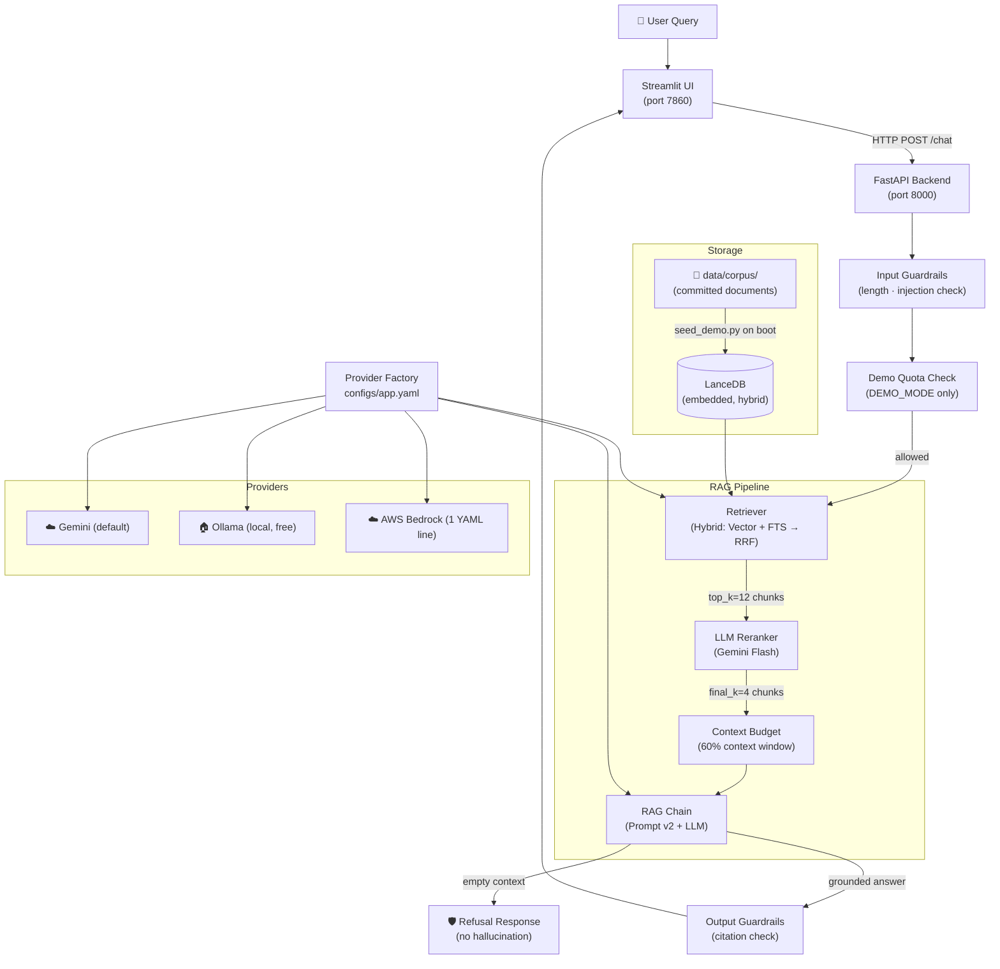

# Enterprise RAG Assistant

<div align="center">

[](https://www.python.org/)
[](https://fastapi.tiangolo.com/)
[](https://docs.ragas.io/)
[](https://mlflow.org/)
[](LICENSE)

**A document Q&A platform that *proves* its answers.**

Most RAG demos stop at "it answers questions." This one **measures** every answer:
retrieval metrics, RAGAS generation metrics, hallucination gating, and versioned prompts with A/B experiment tracking — all visible in the built-in evaluation lab.

**[🚀 Live Demo →](https://huggingface.co/spaces/jayeshsingh001/enterprise-rag-assistant)**

</div>

---

## The Headline Result

A single prompt version upgrade — combined with hybrid retrieval and LLM reranking — reduced hallucination rate from **25% → 8%** and pushed refusal accuracy to **100%**:

| Configuration | Faithfulness | Refusal Accuracy | MRR |
|:---|:---:|:---:|:---:|
| Run A — Vector only (baseline) | — | — | 0.833 |
| Run B — + Hybrid RRF | — | — | 0.800 |
| Run C — + LLM Reranker | **0.75** | 0.60 | 0.867 |
| **Run D — + Strict Prompt v2** | **0.92 ✅** | **1.00 ✅** | 0.867 |

> One configuration lever changed at a time. Every number is reproducible — see [`eval/reports/`](eval/reports/).

---

## Features

| | |
|---|---|
| 📄 **Document Ingestion** | PDF, Markdown, plain text; chunked & embedded automatically |
| 🔍 **Hybrid Retrieval** | Dense vector + full-text search fused via Reciprocal Rank Fusion |
| 🏆 **LLM Reranking** | Gemini Flash reranks candidates — no PyTorch/CUDA required |
| 💬 **Grounded Q&A** | Every answer includes cited passage, source doc, and 4 retrieval scores |
| 🛡️ **Refusal Path** | Hard refuses when context is insufficient — zero hallucination > wrong answer |
| 📊 **Evaluation Lab** | RAGAS faithfulness/relevancy + IR metrics (Hit Rate, MRR, NDCG) |
| 🔬 **Experiment Tracking** | MLflow-tracked prompt versions and eval runs (local dev only) |
| 🔌 **Multi-Provider** | Swap Gemini ↔ Ollama ↔ Bedrock with a **single YAML line** |

---

## Architecture



---

## Tech Stack

| Layer | Technology | Why |
|---|---|---|
| Backend | FastAPI + Uvicorn | Auto-generated OpenAPI docs; async-ready; production-grade |
| UI | Streamlit | Data-focused UI with minimal boilerplate; backend-decoupled via HTTP |
| Vector Store | LanceDB | Embedded (no daemon), native hybrid search, file-based — zero ops overhead |
| LLM | Gemini 3.5 Flash (default) | Free tier; fast; swappable via one YAML line |
| Embeddings | `gemini-embedding-001` | 3072-dim; matched per provider in config |
| Hybrid Search | RRF (Vector + FTS) | Handles both semantic intent and exact enterprise jargon |
| Reranker | LLM-based (Gemini Flash) | No PyTorch/CUDA; trivially swappable; keeps image <2 GB |
| Evaluation | RAGAS + custom IR metrics | Faithfulness, relevancy, Hit Rate@K, MRR, NDCG |
| Tracking | MLflow (local dev only) | Prompt registry + experiment comparison; gracefully absent in prod |
| Language | Python 3.11 + Pydantic v2 | Type safety everywhere; Pydantic Settings for config |
| Packaging | `uv` + `pyproject.toml` | 10× faster than pip; dependency groups (dev vs prod) |
| Deployment | Docker → Hugging Face Spaces | Free public demo; self-seeding on ephemeral disk |

---

## Quick Start

### Option A — Local with Ollama (zero cost, no API key)

```bash
# 1. Install Ollama: https://ollama.com
ollama pull llama3.2
ollama pull nomic-embed-text

# 2. Clone and install
git clone https://github.com/jayesheuro/enterprise-rag-assistant
cd enterprise-rag-assistant
uv sync

# 3. Switch provider to Ollama (one line)
# Edit configs/app.yaml:  provider: ollama

# 4. Start backend
uv run uvicorn app.main:app --reload

# 5. Start UI (new terminal)
uv run streamlit run ui/Home.py
```

### Option B — Gemini (free API key, cloud)

```bash
# 1. Get a free key at https://aistudio.google.com/apikey
cp .env.example .env
# Edit .env: GOOGLE_API_KEY=your_key_here

# 2. Install and run
uv sync
uv run uvicorn app.main:app --reload
uv run streamlit run ui/Home.py

# 3. Ingest the sample corpus
uv run python scripts/ingest.py data/corpus/
```

### Option C — Docker (mirrors the HF Spaces deployment)

```bash
docker build -t enterprise-rag-assistant .

docker run -p 7860:7860 \
  -e GOOGLE_API_KEY=your_key_here \
  -e DEMO_MODE=true \
  enterprise-rag-assistant

# Open: http://localhost:7860
```

---

## Switching Providers — One YAML Line

```yaml
# configs/app.yaml
provider: gemini   # ← change to: ollama  or  bedrock
```

That's it. No code changes. The Factory reads this at startup and wires the correct `BaseLLM` + `BaseEmbedder` implementation. Provider-specific settings live in `configs/providers/<name>.yaml`.

**AWS Bedrock swap example** (for production):
```yaml
# configs/app.yaml
provider: bedrock
```
```yaml
# configs/providers/bedrock.yaml
model: anthropic.claude-3-haiku-20240307-v1:0
embedding_model: amazon.titan-embed-text-v2:0
region: us-east-1
```
Set `AWS_ACCESS_KEY_ID`, `AWS_SECRET_ACCESS_KEY` in `.env`. Done.

---

## Evaluation Methodology

The system evaluates itself across two tiers:

**Retrieval metrics** (no LLM needed — pure IR):
- **Hit Rate@K** — Did the correct document appear in the top-K results?
- **Recall@K** — What fraction of relevant documents were recalled?
- **MRR** — Was the most relevant document ranked first?
- **NDCG@K** — How well-ordered is the ranking?

**Generation metrics** (LLM-as-judge via RAGAS):
- **Faithfulness** — Is every claim in the answer supported by the retrieved context?
- **Answer Relevancy** — Does the answer actually address the question asked?
- **Refusal Accuracy** — Does the system correctly refuse out-of-scope questions?

See [`eval/reports/experiment_1.md`](eval/reports/experiment_1.md) for the full A/B/C/D experiment walkthrough.

---

## Project Structure

```
enterprise-rag-assistant/
├── app/                        # FastAPI backend
│   ├── api/routes/             # chat.py, ingest.py, eval.py, health.py
│   ├── core/                   # Config, logging, exceptions
│   ├── models/                 # Pydantic request/response schemas
│   └── services/
│       ├── providers/          # BaseLLM/BaseEmbedder + Gemini/Ollama/Bedrock impls
│       ├── ingestion/          # Document loaders, chunkers, pipeline
│       ├── retrieval/          # LanceDB vector store, hybrid retriever, reranker
│       ├── generation/         # Prompt builder, RAG chain, guardrails
│       ├── evaluation/         # RAGAS runner, IR metrics, eval report
│       ├── tracking/           # MLflow tracker with NoOpTracker fallback
│       └── quota/              # Global daily demo quota (DEMO_MODE only)
├── ui/                         # Streamlit app (fully decoupled via HTTP)
│   └── pages/                  # Chat, Eval Dashboard, Ingestion, About
├── configs/                    # YAML configuration
│   ├── app.yaml                # Active provider + chunking + retrieval settings
│   └── providers/              # gemini.yaml, ollama.yaml, bedrock.yaml
├── prompts/                    # Versioned prompt templates (YAML)
├── data/corpus/                # Sample enterprise documents (synthetic)
├── eval/
│   ├── golden/                 # Hand-verified Q&A dataset (30 questions)
│   └── reports/                # Eval results + experiment narrative
├── docs/architecture/          # Architecture Decision Records (ADR-001 → ADR-020)
├── scripts/                    # ingest.py, run_eval.py, seed_demo.py, smoke_test.py
├── tests/                      # pytest unit + integration tests
├── Dockerfile                  # Production container
├── start.sh                    # Container entrypoint (seed → uvicorn → streamlit)
└── .env.example                # All env vars documented
```

---

## Roadmap

- [ ] Multi-turn conversation with memory (session context window management)
- [ ] Cross-encoder reranker (ColBERT / sentence-transformers) as an alternative to LLM reranker
- [ ] React/Next.js frontend (the HTTP API is already the interface — zero backend changes)
- [ ] Eval-gated CI (GitHub Actions runs eval on PR; blocks merge if faithfulness drops)
- [ ] Authentication (JWT / API key middleware for enterprise deployment)
- [ ] OpenSearch / pgvector migration path for horizontal scaling

---

## License

MIT — see [LICENSE](LICENSE).

---

<div align="center">
Built as a portfolio-grade AI engineering project demonstrating production RAG patterns,
evaluation methodology, and multi-provider LLM abstraction.
</div>
